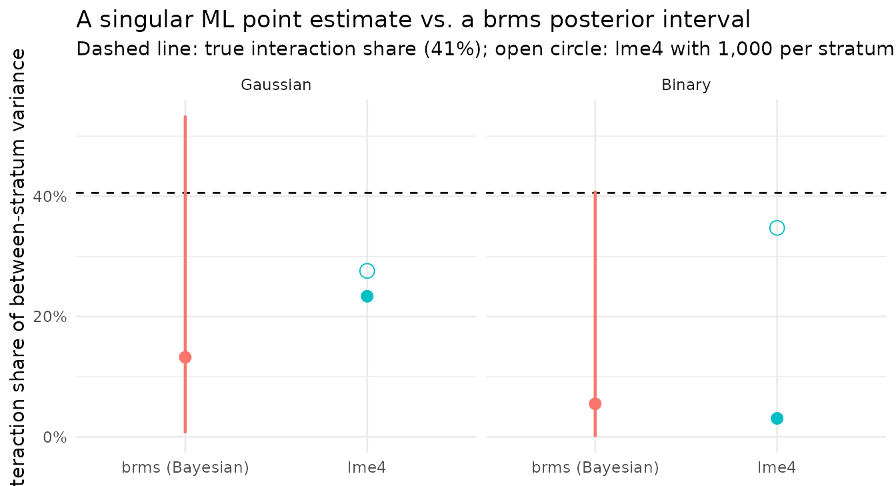

# Bayesian MAIHDA for sparse intersections

## Sparse intersectional cells

Intersectional MAIHDA decomposes the between-stratum variation into an
additive part (the constituent dimensions’ main effects) and an
interaction part (the model-implied departure from additivity). That
conclusion is defensible only when each intersectional stratum is
populated well enough to estimate its effect. In practice it often is
not. Crossing several dimensions multiplies the strata while the sample
size stays fixed, so cell counts fall away quickly. Estimating an
interaction variance from cells like these is hard.

## A dataset with a known interaction

`maihda_sparse_data` is simulated for exactly that: 4 dimensions form 36
intersectional strata, and the interaction accounts for **41% of the
variance between the 36 stratum effects** – on a Gaussian outcome `y`
and on the latent scale of a binary outcome `event`
([`?maihda_sparse_data`](https://hdbt.github.io/MAIHDA/reference/maihda_sparse_data.md)
gives the split). Individuals are allocated to strata unevenly,
reproducing the skewed cell sizes of real survey data.

``` r

data(maihda_sparse_data)
d <- maihda_sparse_data

cells <- table(interaction(d$gender, d$ethnicity, d$education, d$age_group, drop = TRUE))
summary(as.numeric(cells))                    # cell-size distribution
#>    Min. 1st Qu.  Median    Mean 3rd Qu.    Max. 
#>   1.000   4.000   6.000   6.667   9.250  17.000
sum(cells < 5)                                # how many strata have < 5 people
#> [1] 12
attr(d, "truth")$gaussian$interaction_share   # the true interaction share: 0.41
#> [1] 0.4056439
```

A third of the strata hold fewer than five individuals. This is not an
unusual case, as it is often the situation once more than two or three
dimensions are crossed, and it is precisely where maximum likelihood
becomes unreliable.

## What lme4 reports

We fit the crossed-dimensions decomposition with `engine = "lme4"` on
both outcomes.

``` r

m_g <- maihda(y ~ 1 + (1 | gender:ethnicity:education:age_group),
              data = d, decomposition = "crossed-dimensions", engine = "lme4")
m_b <- maihda(event ~ 1 + (1 | gender:ethnicity:education:age_group),
              data = d, decomposition = "crossed-dimensions",
              engine = "lme4", family = "binomial")

c(gaussian = m_g$decomposition$interaction_share,
  binary   = m_b$decomposition$interaction_share)
#>   gaussian     binary 
#> 0.23380215 0.03061958
# The variance of each dimension and of the interaction
round(rbind(
  gaussian = c(m_g$decomposition$per_dim, interaction = m_g$decomposition$interaction_var),
  binary   = c(m_b$decomposition$per_dim, interaction = m_b$decomposition$interaction_var)
), 3)
#>          gender ethnicity education age_group interaction
#> gaussian      0     0.034     0.203     0.107       0.105
#> binary        0     0.000     0.501     0.190       0.022
```

In both fits maximum likelihood has placed a dimension’s variance at
zero (gender’s in the Gaussian fit; gender’s and ethnicity’s in the
binary one), and the interaction variance is positive in both. The
interaction share is understated all the same, at 23% for the Gaussian
outcome and 3% for the binary one, against a true 41%.

Only part of that gap is the sparse cells. The share is the interaction
variance over the sum of the four dimension variances and its own, and a
dimension’s variance, estimated from two or three levels, describes the
population its levels come from: together the four are larger than the
spread of the main effects among the 36 strata. Fitted to the same
stratum effects with 1,000 individuals in every stratum, lme4 puts the
share at 28% for the Gaussian outcome and 35% for the binary one. The
two outcomes’ effects differ only in scale: the gap between these two is
that of REML (Gaussian) and maximum likelihood (binary). The Gaussian
23% is close to 28%; on the binary outcome the sparse cells make a
substantial interaction look absent. Neither estimate comes with an
interval in this output. Asked for one (`bootstrap = TRUE`),
[`maihda()`](https://hdbt.github.io/MAIHDA/reference/maihda.md)
simulates outcomes from the fitted model and refits it; the interval for
the interaction share then runs from 0% to about 90% on the Gaussian
outcome and over the whole range on the binary one. The sparse cells
barely constrain the split. The draws are simulated from the fit itself,
so none of them has a gender effect.

## What brms adds: posterior uncertainty

Refitting with `engine = "brms"` and a weakly-informative prior on the
random-effect standard deviations changes the output in one important
respect: the posterior yields a credible interval in place of a single
number. No standard deviation is reported at zero, since each is a
posterior median, which is above zero whatever the prior; the
`normal(0, 0.5)` prior has its mode at zero and pulls the standard
deviations toward it. The call is shown but not evaluated here (`brms`
requires Stan and several minutes; see the note on precomputation
below).

``` r

set.seed(1)
m_g_brms <- maihda(
  y ~ 1 + (1 | gender:ethnicity:education:age_group),
  data = d, decomposition = "crossed-dimensions", engine = "brms",
  prior = brms::set_prior("normal(0, 0.5)", class = "sd"),
  chains = 4, iter = 2000, warmup = 1000, cores = 4,
  control = list(adapt_delta = 0.97)
)
m_g_brms$decomposition$interaction_share
m_g_brms$decomposition$interaction_share_ci
```

The cached posterior summaries:

``` r

bg <- pc$brms$gaussian; bb <- pc$brms$binary
data.frame(
  outcome      = c("Gaussian", "Binary"),
  true_share   = c(pc$truth$gaussian$interaction_share, pc$truth$binary_latent$interaction_share),
  brms_share   = c(bg$share, bb$share),
  ci_low       = c(bg$ci[1], bb$ci[1]),
  ci_high      = c(bg$ci[2], bb$ci[2]),
  max_rhat     = c(bg$diag$max_rhat, bb$diag$max_rhat),
  divergences  = c(bg$diag$divergences, bb$diag$divergences)
)
#>    outcome true_share brms_share      ci_low   ci_high max_rhat divergences
#> 1 Gaussian  0.4056439 0.13223468 0.005891153 0.5341915 1.006180           0
#> 2   Binary  0.4056439 0.05492321 0.000119476 0.4090562 1.001815           0
```

The posterior median is low as well: `brms` reports the same ratio of
variance parameters, which is not the 41% of the drawn strata, and with
two or three levels its value depends on the prior on the dimensions’
standard deviations. The credible interval, however, runs from near zero
to past the true value, reflecting posterior uncertainty about the
interaction share. This is the substantive difference. Maximum
likelihood’s default output is a single point; `brms` reports an
interval that includes the true share in this simulation and makes the
uncertainty explicit. The diagnostics (`max_rhat` close to 1, no
divergent transitions) suggest the posterior is well-sampled.

These summaries also depend on the prior on the random-effect standard
deviations, `normal(0, 0.5)` above and `normal(0, 1)` for the binary
fit: each of the four dimensions has two or three levels, and the
variance of such a dimension follows that prior (see the caveats in
[`vignette("cross_classified", package = "MAIHDA")`](https://hdbt.github.io/MAIHDA/articles/cross_classified.md)).
Refitted under brms’s default prior instead, the interaction share is
about 3% for both outcomes, and the intervals end between 25% and 31%
(the upper limit moves with the sampler’s seed), short of the true 41%.

## Comparison

``` r

fig <- data.frame(
  outcome = factor(rep(c("Gaussian", "Binary"), each = 2), levels = c("Gaussian", "Binary")),
  method  = rep(c("lme4", "brms (Bayesian)"), 2),
  share   = c(pc$lme4$gaussian$share, pc$brms$gaussian$share,
              pc$lme4$binary$share,   pc$brms$binary$share),
  lo      = c(NA, pc$brms$gaussian$ci[1], NA, pc$brms$binary$ci[1]),
  hi      = c(NA, pc$brms$gaussian$ci[2], NA, pc$brms$binary$ci[2])
)
truth <- pc$truth$gaussian$interaction_share
large <- data.frame(
  outcome = factor(c("Gaussian", "Binary"), levels = c("Gaussian", "Binary")),
  method  = "lme4",
  share   = c(pc$lme4_large$gaussian$share, pc$lme4_large$binary$share)
)

ggplot(fig, aes(method, share, colour = method)) +
  geom_hline(yintercept = truth, linetype = "dashed") +
  geom_pointrange(aes(ymin = lo, ymax = hi), na.rm = TRUE, linewidth = 0.8) +
  geom_point(size = 2.5) +
  geom_point(data = large, shape = 1, size = 3.5) +
  facet_wrap(~ outcome) +
  scale_y_continuous("Interaction share of between-stratum variance",
                     labels = function(x) paste0(round(100 * x), "%")) +
  labs(x = NULL, colour = NULL,
       title = "A singular ML point estimate vs. a brms posterior interval",
       subtitle = paste0("Dashed line: true interaction share (", pct(truth),
                         "); open circle: lme4 with 1,000 per stratum")) +
  theme_minimal() + theme(legend.position = "none")
```



Both point estimates fall below the true value and below lme4’s share
with ample data (the open circles). They differ in what is reported
alongside the point. The `brms` credible interval spans the true 41%,
whereas `lme4` reports a single value unless it is bootstrapped. Reading
the `lme4` point at face value (an interaction of roughly 3–23%) is the
error the singular fit invites.

## Why the interval, not the point, is what changes

The per-stratum effects (the stratum random intercepts) are similar
under the two engines as both apply partial pooling, shrinking
thinly-estimated strata toward the additive prediction. What differs is
the treatment of uncertainty. Maximum likelihood commits to a single
variance decomposition and gives no interval for it unless one is
bootstrapped from that decomposition. `brms` propagates the full
posterior, so the interaction share is accompanied by an interval whose
width reflects how little the sparse cells constrain it. Summarising the
posterior by its point discards exactly the information that matters:
the degree of uncertainty. When intersectional cells are sparse, a
regularised Bayesian fit with an explicit interval is the more
defensible summary, read with the priors it rests on.

The two-model PCV is the exception. `maihda(engine = "brms")` with the
default `decomposition = "two-model"` fits the null and the adjusted
model separately, so there is no joint posterior to take a PCV interval
from. The PCV it reports is a point estimate, one minus the ratio of the
two models’ posterior-median between-stratum variances, and with few
strata it is understated – the reverse of the maximum-likelihood PCV,
which is overstated (see
[`?calculate_pcv`](https://hdbt.github.io/MAIHDA/reference/calculate_pcv.md)).
